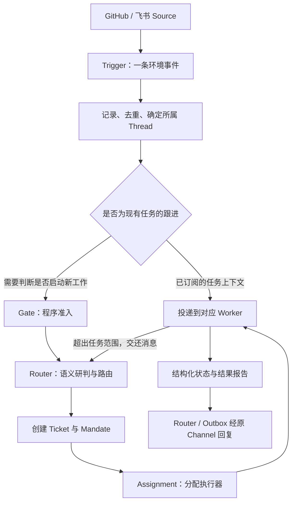

# DeepSeek Super-agent 设计解读

> 阅读日期：2026-10-31。以公开原型提交 `6337fc823ce20251c8de8085948165c81aaa701e` 为源码依据。
> 本文是中文解读；文章全文、官方文档、源码及下载记录见[资料存档](../00-resource/references/dsh-superagent-2026-10-31/README.md)。

## 一、它解决什么问题

单任务 Agent 越来越能自行执行，但同时处理多个任务时，人仍要切换会话、补充上下文、跟进执行、转发结果。Super-agent 把这些管理工作交给系统，使人主要负责确定目标、关键决策与验收。

其设计目标是连续、高效、主动、持久：跨飞书与 GitHub 延续同一项工作，多任务并发，根据授权规则主动处理环境事件，并在长期运行中恢复故障。

`dsh-superagent-prototype` 是基于 DeepSeek Harness 的研究原型，当前面向一个 GitHub 仓库，可选接入飞书。文章讨论的架构范围大于公开代码，不能把文章中的全部能力当作插件现有功能。

## 二、核心设计

### 1. Router 管全局，Worker 做具体任务

Router 是常驻的协调会话，理解新请求、识别任务关系、分派工作、统一沟通。具体编码、测试与问题复现交给上下文隔离的 Worker。每个 Worker 可在内部使用 Subagent，但任务内部的拆解不需要 Router 参与。

这样把交互连续性与执行并发分开：用户面对一个持续在线的协作者，底层却能有多个独立执行会话。Worker 的长日志和工具细节不必进入 Router 上下文，也不必发到群聊。

Router 的轻量职责有利于使用更快的模型；Worker 的模型能力更直接影响交付质量。事件密集时，Router 可将推理期间积压的多条事件合并处理，但批处理仍受窗口容量和模型判断能力限制。

### 2. 新任务走研判，后续事件走订阅

- **Source**：事件来源适配器，负责接入平台、读位置、机器人身份。
- **Trigger**：不可变事件，例如一条评论、一条群消息、一次 CI 状态变化；也是去重与审计的单位。
- **Thread**：平台上的连续事件流，例如一个 PR 或飞书话题，不是操作系统线程。
- **Subscription**：Thread 与 Ticket 的多对多订阅关系，将后续事件直接投递给相关任务。
- **Channel**：对外写入的渠道，负责把确认、问题与结果送回适当的原会话。

两条路径可以同时发生，尤其机器人消息既可作为已订阅任务的上下文，也可能被独立研判。普通人对任务的跟进若已归执行器处理，就不再重复评估；超出范围时，由执行器交还 Router。

这条直通路径减少 Router 反复转发评论、测试结果的负担。系统为每个 Thread 串行运行一次 Eval，其间到达的事件进入下一批，避免同一条事件流被并行做出相互冲突的研判。

### 3. 上下文按缓存组织：Inline、Spill 与链式召回

近期大概率用到的内容直接放进上下文，称为 Inline；长正文或低频信息保存在窗口外，只留摘要、ID 和续读入口，称为 Spill。

原型对 Trigger、Ticket、Thread 等资源提供分页读取。卡片保留关联对象 ID，模型可以沿引用逐步找到历史：当前消息 → Thread → Ticket → 执行报告或另一个 PR Thread。这就是文章的 Chain of Recall。

它依靠对象引用与按需读取恢复上下文，不要求把所有历史塞进提示词，也不能等同于已经解决跨月记忆。公开实现中，执行器仅能通过应用读取接口访问自己任务的相应资源。

### 4. 授权与上下文分开

Gate 用确定性程序检查来源、身份、接收范围与准入表；模型负责理解候选事件是否满足自然语言规则。明确请求与推断出的主动任务分别处理。

主动接单有三种模式：`off` 不受理推断候选；默认 `observe` 只记录本来会接什么，不创建主动任务；`auto` 才真正接单，且必须匹配启用的规则。

接单形成不可变的 **Mandate**，记录授权范围、强度、策略版本和匹配规则。订阅得到的新消息只是上下文，不会自动扩大授权。超出范围应交回研判，新增更大范围的工作需要新 Ticket。

策略变化会使旧版本的在途研判失效重排，并通知受影响的运行任务；它不会立刻取消所有运行任务。已结束任务要恢复时，必须重新验证 Mandate。人工明确停止的任务不会被后续普通消息自动恢复。

### 5. 异步交互与低打扰输出

文章提出将耗时工具调用改成启动、后台运行、完成事件回投的异步循环。用户的新消息在当前推理步结束后即可处理，不必等长命令结束。这不意味着可以中断正在生成的一次模型推理。

原型将主会话与执行器的前台 shell 命令在 5 秒后转为后台任务。后台任务尚未完成时，Worker 通常继续占执行槽位；准备交付或向人提问时则释放槽位。并发满时，还为人工跟进或状态请求保留一个额外槽位，避免新工作阻塞人对已有工作的介入。

沟通原则是只在结果有用、需要决定或无法完成时发言，面板优先显示需要人处理的事项。主动行动以团队明确写下的规则为前提；可以静默尝试复现，发现有价值的修复才交付。

## 三、实现逻辑：从一条消息到一个 PR

假设允许名单内的人在飞书说“@机器人，修复登录超时”：

1. 飞书 Source 将平台消息转成 Trigger，记录身份、是否被 @、Thread 和回复地址。
2. `Engine.receive()` 在事务中完成去重、存储、订阅扇出及待研判队列更新。新请求没有归属任务时走 Eval。
3. Gate 检查授权基础，主会话读取必要上下文，决定接受、附加到已有任务、停止或忽略。接单创建 Ticket 与 Mandate。
4. 执行器获得 Assignment。每个 Ticket 有持久的 `worker-<ticket id>` 会话和独立目录；配置的 prepare 命令可创建 `git worktree`，默认没有配置时只是空目录。
5. Worker 复现、修改、运行测试并创建 PR，报告状态和 PR。原型以明确规则关联工单与分支/PR，再订阅相关评审与 CI Thread。
6. PR 评论、CI 结果等通过订阅进入同一 Ticket。Worker 处理任务范围内的跟进；新需求交还 Router，避免静默扩大任务。
7. Worker 通过结构化 Report 提交进展、等待、就绪、受阻或失败。Router 经持久化 Outbox 在原会话沟通，面板显示待回答或待审查的工作。
8. 有 PR 的 Ticket 不会因为报告 ready 就直接算完成；还需要满足其跟踪 PR 的关闭/合并规则。重启时保留会话、目录和输入，并建立带恢复说明的新 Assignment。

Ticket 是业务工作的身份，Assignment 是某次执行绑定，Session 是模型上下文。这三者分开后，执行中断不等于任务消失，也不必为重试丢弃原分支与 PR。

### 源码阅读入口

路径均相对于[下载的源码目录](../00-resource/references/dsh-superagent-2026-10-31/dsh-superagent-prototype-main/README.md)。

| 文件 | 主要职责 |
| --- | --- |
| `src/app/runtime.ts` | 组装组件，负责启动、恢复和关闭 |
| `src/core/engine.ts` | 领域修改的统一事务入口 |
| `src/core/intake.ts` | 接收 Trigger、去重、关联、订阅扇出与排队 |
| `src/core/evals.ts`、`src/policy.ts` | 研判、决策与授权策略 |
| `src/core/tickets.ts`、`src/core/assignments.ts` | 任务生命周期、执行绑定与报告 |
| `src/executor/dsh.ts` | Worker 会话、目录、执行槽位与故障恢复 |
| `src/app/effects.ts`、`src/app/outbox.ts` | 持久化副作用队列与消息发送 |
| `src/app/resources.ts` | 按 ID 导航与分页读取的资源接口 |
| `src/sources/`、`prompts/` | 平台适配与模型行为指令 |

其中一个关键工程选择是：**先在事务中保存业务变化和待执行副作用，再在事务提交后调用外部系统**。启动 Worker、投递输入和发送消息都有持久化记录，并按相应规则重试。

这样减少“任务已接受却未分派”“重启后待发消息消失”等不一致。Trigger ID、消息回执以及去重规则降低重复处理，但不能据此宣称所有外部操作都具有 exactly-once 保证。恢复提示仍要求先检查 git 和 GitHub 的实际状态，再决定是否重做外部动作。

## 四、主要优点与代价

| 设计 | 直接收益 | 代价或边界 |
| --- | --- | --- |
| Router 与 Worker 分工 | 前台响应与后台执行分开，多任务上下文隔离 | 多会话增加 token 与运维成本，Router 扩展仍有上限 |
| 程序过滤与订阅直通 | 减少无关消息推理和重复路由 | 需要维护事件归属、订阅与交还规则 |
| Inline / Spill 与引用读取 | 控制窗口占用，保留原文续读能力 | 引用图不等于完整长期记忆，仍需模型正确检索 |
| Ticket / Mandate / Assignment 分离 | 授权可追溯，执行可重试，任务可延续 | 语义上的范围遵守仍部分依赖模型判断 |
| 持久化 Effects / Outbox | 重启恢复，发送顺序和重试可管理 | 外部系统仍可能产生重复动作，历史记录尚无自动清理 |
| 低打扰沟通 | 人主要处理决策与验收 | 规则和提示词需要适配团队习惯 |

文章的初步实验用了约 300 条消息、约 20 个请求，每种方案运行 5 次，用只消耗时间的工具替代真实编码，因此主要检验调度与协作。

| 方案 | 完成时间 p50 / p95（分钟） | 单次实验全部会话读缓存 token |
| --- | --- | --- |
| Super-agent | 12.4 / 15.7 | 2323 万 |
| Super-agent 去掉直通 | 12.6 / 15.5 | 3177 万 |
| 单 Session + Subagent，中性提示 | 20.4 / 29.5 | 605 万 |
| 单 Session + Subagent，提示优先委派 | 13.8 / 29.0 | 1082 万 |

数据来自[全文存档](../00-resource/references/dsh-superagent-2026-10-31/Super-agent%20设计探索（全文转载存档）.md)第 7 节及原文图 13。作者自己的结论也包含代价：更短、更稳定的完成时间伴随更多读缓存 token。直通在这组实验中主要降低路由开销，未体现速度或质量提升，不能将此实验解释为真实代码开发效率或正确率已得到同幅提升。

## 五、文章设计与公开原型的区别

| 能力 | 当前能核实到的情况 |
| --- | --- |
| 单仓库 GitHub、可选飞书接入 | 官方 README 与 Source 实现明确提供 |
| 双层分工、Thread 订阅、结构化任务、授权策略 | 文档和源码提供 |
| 摘要、ID 关联、分页原文读取 | 应用读取接口提供 |
| shell 后台化与完成事件唤醒 | 执行文档与执行器提供；不能等同于文章完整通用异步接口 |
| 计算、持久化状态、远端执行环境三者解耦，BYOM | 文章架构方向；本次公开原型没有提供文中完整云端/端侧 daemon 系统 |
| 独立 Watchdog Session 判断执行是否偏航并自修复 | 文章设计；本次源码未发现对应实现，现有重试、健康检查不等同于该机制 |

原型的会话和工作目录隔离也不是 OS 安全沙箱。官方部署文档明确说 Worker 以操作系统用户身份无审批执行命令，凭据包装器只选择默认账号，不能阻止按绝对路径调用其他程序。它适合作为可信小团队场景下的架构研究样本，授权、凭据隔离与长程记忆仍有工程边界。

## 六、参考资料

- [官方仓库](https://github.com/deepseek-ai/dsh-superagent-prototype)
- [设计文章公众号直链](https://mp.weixin.qq.com/s/zoS7GlReWPhfCjENGxXCdg)
- [标注 DeepSeek 产品部署名的全文转载](https://www.chaincatcher.com/article/2300676)（公众号未直接读取，未逐字比对）
- [官方领域模型](https://github.com/deepseek-ai/dsh-superagent-prototype/blob/main/docs/001-domain.md)
- [官方授权设计](https://github.com/deepseek-ai/dsh-superagent-prototype/blob/main/docs/002-authorization.md)
- [官方执行设计](https://github.com/deepseek-ai/dsh-superagent-prototype/blob/main/docs/003-execution.md)
- [官方实现架构](https://github.com/deepseek-ai/dsh-superagent-prototype/blob/main/docs/007-architecture.md)
