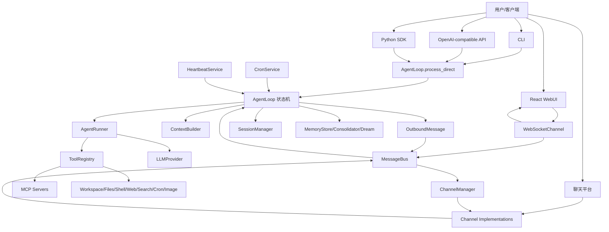
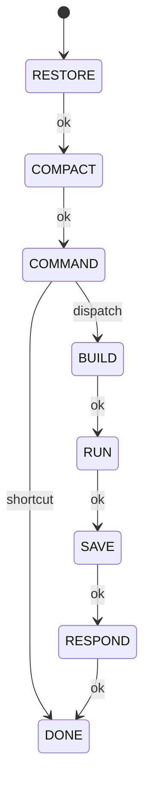

# nanobot 详细设计文档

生成日期：2026-05-28  
适用代码版本：当前仓库工作区

## 1. 项目概览

nanobot 是一个轻量级个人 AI Agent 框架。项目核心目标是把 Agent 主循环保持在较小、可读、可扩展的范围内，同时提供多聊天渠道、WebUI、OpenAI 兼容 API、MCP、技能、记忆、定时任务和容器部署能力。

项目由四类运行入口共享同一套 Agent 内核：

- CLI：`nanobot agent`、`nanobot gateway`、`nanobot serve` 等 Typer 命令。
- SDK：`Nanobot.from_config().run(...)` 程序化调用。
- Gateway：多聊天渠道长期运行服务，基于 `MessageBus` 异步解耦。
- API/WebUI：OpenAI 兼容 HTTP API 和 WebSocket + React WebUI。

## 2. 技术栈

后端：

- Python `>=3.11`，项目包名 `nanobot-ai`。
- CLI：Typer、Rich、prompt-toolkit。
- 配置：Pydantic v2、pydantic-settings。
- LLM SDK：OpenAI SDK、Anthropic SDK、boto3 Bedrock，以及 OpenAI-compatible 封装。
- 异步通信：asyncio、websockets、aiohttp。
- 工具与检索：MCP、ddgs、httpx、readability-lxml。
- 持久化：JSON/JSONL 文件、原子写、局部 git 版本化记忆文件。

前端：

- React 18、TypeScript、Vite。
- Tailwind CSS、Radix UI、lucide-react。
- WebSocket 单连接多会话复用。

桥接服务：

- `bridge/` 是 Node.js 20 + TypeScript 服务。
- WhatsApp 使用 Baileys，并通过本机 WebSocket 与 Python 进程通信。

部署：

- Docker 基于 `ghcr.io/astral-sh/uv:python3.12-bookworm-slim`。
- `docker-compose.yml` 提供 gateway、api、cli profile。

## 3. 目录结构

```text
nanobot/
  api/                 OpenAI-compatible HTTP API
  agent/               AgentLoop、AgentRunner、上下文、记忆、工具、子 Agent
  apps/                CLI App 协议与运行服务
  bus/                 Inbound/Outbound 消息与异步队列
  channels/            Telegram、Slack、WebSocket、Feishu、Email 等渠道
  cli/                 Typer 命令入口与终端交互渲染
  command/             内置 slash command 路由
  config/              Pydantic 配置模型、加载、路径
  cron/                定时任务模型和服务
  heartbeat/           周期性主动检查服务
  pairing/             渠道配对授权
  providers/           LLM Provider 抽象、工厂和各 Provider 实现
  security/            网络安全策略，如 SSRF 保护
  session/             会话、WebUI turn 协调、目标状态
  skills/              内置技能
  templates/           系统提示词、记忆、Agent 模板
  utils/               文件、媒体、token、git、运行时辅助能力
  webui/               WebUI 后端辅助 API
webui/                 React 前端源码
bridge/                WhatsApp Node.js 桥
docs/                  用户文档
tests/                 Python 测试
```

## 4. 总体架构



核心分层：

- 接入层：CLI、SDK、API、WebSocket、各聊天渠道。
- 消息层：`MessageBus` 提供 inbound/outbound 队列，统一消息格式。
- 编排层：`AgentLoop` 负责一次 turn 的状态机、会话、上下文、命令、保存和响应。
- 执行层：`AgentRunner` 负责 LLM 请求、工具调用循环、重试、上下文治理和 checkpoint。
- 能力层：Provider、Tool、MCP、Skills、Memory、Cron、Heartbeat。
- 持久化层：配置文件、workspace、session JSONL、memory JSONL/Markdown、cron store。

## 5. 运行入口设计

### 5.1 CLI 命令

入口文件：

- `nanobot/__main__.py`
- `nanobot/cli/commands.py`

主要命令：

- `onboard`：创建或刷新配置，初始化 workspace，并注入渠道默认配置。
- `agent`：直接交互。单轮模式走 `AgentLoop.process_direct`；交互模式通过 `MessageBus` 跑 `AgentLoop.run()`。
- `gateway`：启动长期服务，包括 AgentLoop、ChannelManager、CronService、HeartbeatService 和 health endpoint。
- `serve`：启动 OpenAI-compatible HTTP API。
- `channels status/login`：查看渠道启用状态、执行渠道登录。
- `plugins list`：列出内置和外部渠道插件。
- `provider login/logout`：OAuth Provider 登录和清除凭据。
- `status`：显示配置、workspace、模型和 Provider 状态。

### 5.2 SDK

`nanobot/nanobot.py` 提供高层接口：

- `Nanobot.from_config(...)` 加载配置、解析环境变量、创建 `AgentLoop`。
- `Nanobot.run(...)` 使用 `SDKCaptureHook` 捕获最终内容、工具使用列表和消息。

SDK 与 CLI/API 共享同一个 `AgentLoop.process_direct` 路径。

### 5.3 OpenAI-compatible API

`nanobot/api/server.py` 暴露：

- `POST /v1/chat/completions`
- `GET /v1/models`
- `GET /health`

设计约束：

- 请求体只支持单条 user message。
- JSON 可携带 text 和 base64 data URL 图片。
- multipart 支持 `message`、`session_id`、`model` 和 `files`。
- `session_id` 映射到 `api:<session_id>`；未传则使用 `api:default`。
- 每个 API session 有独立 `asyncio.Lock`，保证同一会话串行。
- `stream=true` 使用 SSE 输出 OpenAI-compatible chunk。

### 5.4 Gateway

`gateway` 是生产态长期服务：

1. 加载配置，创建 `MessageBus` 和 `SessionManager`。
2. 通过 `build_provider_snapshot` 创建初始 Provider。
3. 创建 workspace 级 `CronService`。
4. 创建 `AgentLoop.from_config(...)`，注入 cron、session、provider snapshot loader。
5. 创建 `ChannelManager`，启动已启用渠道。
6. 创建 `HeartbeatService`。
7. 注册 Dream 系统 cron job。
8. 并发运行 `agent.run()`、`channels.start_all()` 和健康检查端口。

Gateway 中 `MessageTool` 被注入发送回调，使 Agent 可以主动向渠道发消息，并按需把主动投递写回目标会话历史。

## 6. 消息模型与总线

`nanobot/bus/events.py` 定义统一消息：

- `InboundMessage`
  - `channel`
  - `sender_id`
  - `chat_id`
  - `content`
  - `media`
  - `metadata`
  - `session_key_override`
  - `session_key = session_key_override or f"{channel}:{chat_id}"`

- `OutboundMessage`
  - `channel`
  - `chat_id`
  - `content`
  - `reply_to`
  - `media`
  - `metadata`
  - `buttons`

`nanobot/bus/queue.py` 的 `MessageBus` 是两个 `asyncio.Queue`：

- inbound：渠道或 WebSocket 向 Agent 投递用户消息。
- outbound：Agent 向渠道投递回复、进度、流式片段、状态事件。

这个设计让渠道实现只关心平台 I/O，Agent 核心不依赖具体平台 SDK。

## 7. AgentLoop 设计

核心文件：`nanobot/agent/loop.py`

`AgentLoop` 是产品层的 Agent 编排器，职责包括：

- 初始化 Provider、ContextBuilder、SessionManager、ToolRegistry、AgentRunner、SubagentManager。
- 注册工具和 MCP。
- 处理 CLI/API 直连请求。
- 从 `MessageBus` 消费消息并调度任务。
- 对同一 session 串行执行，对不同 session 并发执行。
- 支持 mid-turn follow-up injection。
- 支持 `/stop`、`/restart` 等优先命令。
- 持久化用户消息、助手消息、工具结果和 runtime checkpoint。
- 执行自动压缩、token consolidation、Dream/Heartbeat/Cron 相关协作。

### 7.1 Turn 状态机

一次普通消息处理使用 `TurnState` 状态机：



各状态职责：

- `RESTORE`：处理媒体/文档提取，获取 session，恢复上次中断的 checkpoint 或 pending user turn。
- `COMPACT`：执行 idle auto compact 准备，把上次摘要注入本轮上下文。
- `COMMAND`：slash command 分发；命令可直接返回，也可改写成普通 Agent turn。
- `BUILD`：执行 token consolidation、设置工具上下文、读取会话历史、构建 LLM messages、提前持久化用户消息。
- `RUN`：调用 `AgentRunner` 执行模型与工具循环。
- `SAVE`：保存新增消息，清理 pending/checkpoint，触发后台 consolidation。
- `RESPOND`：组装 `OutboundMessage`。

### 7.2 并发与会话隔离

`AgentLoop.run()` 从 `MessageBus` 读 inbound：

- `effective_session_key` 默认是 `channel:chat_id`。
- 配置 `unified_session=true` 时，所有渠道共享 `unified:default`。
- 每个 session 有 `asyncio.Lock`，保证同一会话不会并发改写历史。
- `NANOBOT_MAX_CONCURRENT_REQUESTS` 控制全局并发，默认 3。
- 活跃 session 会有 pending queue，新消息会注入当前 turn，而不是启动竞争任务。
- `/stop`、`/restart`、`/status` 是 priority command，可在任务运行中优先处理。

## 8. AgentRunner 设计

核心文件：`nanobot/agent/runner.py`

`AgentRunner` 是无产品绑定的工具调用循环。输入是 `AgentRunSpec`，输出是 `AgentRunResult`。

主要职责：

- 请求模型：使用 Provider 的 `chat_with_retry` 或 `chat_stream_with_retry`。
- 工具调用：解析 `ToolCallRequest`，调用 `ToolRegistry.prepare_call/execute`。
- 并发工具：开启 `concurrent_tools=True` 时，按工具的 `concurrency_safe` 分批执行。
- 消息治理：丢弃 orphan tool result、补齐缺失 tool result、压缩旧工具结果、按 token budget 截断历史。
- 错误恢复：空响应重试、length recovery、模型 transient retry、工具错误提示。
- 安全边界处理：SSRF、workspace violation 作为可恢复工具错误反馈给模型。
- Checkpoint：在等待工具、工具完成等阶段回调保存 runtime checkpoint。
- Injection：执行工具后或错误后消费 pending user follow-up。
- Sustained goal：目标仍活跃时可自动注入 continuation prompt。

简化执行流程：

```mermaid
sequenceDiagram
  participant Loop as AgentLoop
  participant Runner as AgentRunner
  participant LLM as LLMProvider
  participant Tools as ToolRegistry

  Loop->>Runner: run(AgentRunSpec)
  loop max_iterations
    Runner->>Runner: context governance
    Runner->>LLM: chat/chat_stream with retry
    LLM-->>Runner: LLMResponse
    alt has executable tool calls
      Runner->>Loop: checkpoint awaiting_tools
      Runner->>Tools: execute tool calls
      Tools-->>Runner: tool results
      Runner->>Loop: checkpoint tools_completed
      Runner->>Runner: drain injections
    else final answer
      Runner->>Runner: finalize content
      Runner-->>Loop: AgentRunResult
    end
  end
```

## 9. 上下文、提示词、技能与记忆

### 9.1 ContextBuilder

核心文件：`nanobot/agent/context.py`

`ContextBuilder.build_messages(...)` 生成一次 LLM 请求的 messages：

- system prompt：
  - `templates/agent/identity.md`
  - workspace 中的 `AGENTS.md`、`SOUL.md`、`USER.md`
  - `templates/agent/tool_contract.md`
  - `memory/MEMORY.md`
  - always-on skills
  - skills summary
  - recent unprocessed history
  - session archived summary

- history：
  - 来自 `Session.get_history(...)`
  - 只取未 consolidation 的尾部，按消息数和 token budget 截断。

- current user message：
  - 用户内容。
  - 可选图片转 base64 `image_url` block。
  - 末尾追加 Runtime Context，包含时间、channel、chat_id、sender_id、goal/MCP/CLI app 等运行态元数据。

Runtime Context 被标记为 metadata，不作为用户指令，用于降低 prompt injection 风险。

### 9.2 Skills

技能文件位于：

- 内置：`nanobot/skills/<name>/SKILL.md`
- 用户 workspace：`<workspace>/skills/<name>/SKILL.md`

技能由 `SkillsLoader` 发现并在 system prompt 中暴露摘要或全文。`disabled_skills` 可屏蔽指定技能。

### 9.3 Session

核心文件：`nanobot/session/manager.py`

会话是短中期上下文，存储在：

```text
<workspace>/sessions/<safe_session_key>.jsonl
```

特点：

- 每个文件首行为 metadata。
- 后续每行是一个消息对象。
- 保存使用 temp file + `os.replace`，可选 fsync。
- 读取损坏文件时尝试 repair。
- `get_history` 会过滤 command、清理 replay artifact、补充图片/CLI app/MCP breadcrumb。
- 超过 `FILE_MAX_MESSAGES` 时保留合法尾部，并把旧消息 raw archive 到 memory。

### 9.4 MemoryStore / Consolidator / Dream

核心文件：`nanobot/agent/memory.py`

长期记忆文件：

```text
<workspace>/memory/MEMORY.md
<workspace>/memory/history.jsonl
<workspace>/memory/.cursor
<workspace>/memory/.dream_cursor
<workspace>/SOUL.md
<workspace>/USER.md
```

三层机制：

- `MemoryStore`：纯文件 I/O，维护 MEMORY、history、SOUL、USER 和 cursor。
- `Consolidator`：轻量 consolidation。会在 session 上下文接近 token budget 时，把旧消息摘要写入 `history.jsonl`。
- `Dream`：重量级两阶段记忆处理。
  - Phase 1：读取未处理 history、当前 MEMORY/SOUL/USER，生成分析。
  - Phase 2：通过最小工具集读写 memory/user/soul/skills。
  - 成功后推进 `.dream_cursor`。
  - 如果 memory git store 初始化，自动提交 Dream 变更。

## 10. Provider 设计

核心文件：

- `nanobot/providers/base.py`
- `nanobot/providers/registry.py`
- `nanobot/providers/factory.py`

### 10.1 抽象接口

`LLMProvider` 定义：

- `chat(...) -> LLMResponse`
- `chat_stream(...) -> LLMResponse`
- `chat_with_retry(...)`
- `chat_stream_with_retry(...)`
- `get_default_model()`

`LLMResponse` 统一表示：

- `content`
- `tool_calls`
- `finish_reason`
- `usage`
- reasoning/thinking 字段
- 结构化错误元数据和 retry-after 信息

`ToolCallRequest` 统一模型侧工具调用，并可序列化为 OpenAI tool_call 格式。

### 10.2 ProviderRegistry

`providers/registry.py` 是 Provider 元数据单一来源。`ProviderSpec` 描述：

- config 字段名。
- model 关键字匹配。
- backend 类型。
- 默认 API base。
- gateway/local/oauth/direct 标记。
- reasoning/thinking 注入方式。
- prompt caching、max completion token 等能力。

当前支持 native Anthropic、Azure OpenAI、AWS Bedrock、OpenAI Codex、GitHub Copilot，以及大量 OpenAI-compatible provider/gateway/local endpoint。

### 10.3 ProviderFactory

`make_provider(config)` 流程：

1. 解析当前 model preset。
2. 根据显式 provider 或模型名自动匹配 ProviderSpec。
3. 创建具体 Provider：
   - `OpenAICompatProvider`
   - `AnthropicProvider`
   - `AzureOpenAIProvider`
   - `BedrockProvider`
   - `OpenAICodexProvider`
   - `GitHubCopilotProvider`
4. 应用 generation settings。
5. 如果配置 `fallback_models`，用 `FallbackProvider` 包装主 Provider。

Gateway 模式还会使用 `ProviderSnapshot` 和 signature，支持运行时配置变化后切换模型/Provider。

## 11. Tool 设计

核心文件：

- `nanobot/agent/tools/base.py`
- `nanobot/agent/tools/registry.py`
- `nanobot/agent/tools/loader.py`

### 11.1 Tool 抽象

每个工具继承 `Tool`，必须实现：

- `name`
- `description`
- `parameters`
- `execute(**kwargs)`

可选属性：

- `read_only`
- `concurrency_safe`
- `exclusive`
- `config_key`
- `_scopes`
- `enabled(ctx)`
- `create(ctx)`
- `config_cls()`

参数 schema 使用 JSON Schema。工具调用前会进行类型 cast 和 validate。

### 11.2 ToolRegistry

职责：

- 注册/注销工具。
- 缓存并稳定排序工具定义。
- MCP 工具按 `mcp_` 前缀排在内置工具后。
- `prepare_call` 做查找、cast、validate。
- `execute` 捕获异常并返回可供 LLM 重新规划的错误提示。

### 11.3 ToolLoader

`ToolLoader` 通过两种方式发现工具：

- 扫描 `nanobot.agent.tools` 包中的内置模块。
- 读取 Python entry point group `nanobot.tools`。

`AgentLoop._register_default_tools()` 创建 `ToolContext`，加载工具后再手动注册需要 runtime state 的 `MyTool`。

内置工具覆盖范围包括文件系统、shell、搜索、web、MCP、cron、message、subagent、image generation、CLI apps、self/runtime state 等。

## 12. MCP 设计

MCP 配置位于 `tools.mcp_servers`，单个 server 用 `MCPServerConfig` 描述：

- stdio：`command`、`args`、`env`、`cwd`
- HTTP/SSE：`url`、`headers`
- `tool_timeout`
- `enabled_tools`

运行时：

- `AgentLoop._connect_mcp()` 调用 `agent.context.connect_mcp(...)`。
- MCP 工具注册到 `ToolRegistry`，名称统一包装为 `mcp_<server>_<tool>`。
- WebUI 可通过 MCP preset 动态附加配置，runtime metadata 会提示本 turn 可用能力。
- runtime control message 可触发 MCP reload。

## 13. Channel 与 WebUI 设计

### 13.1 BaseChannel

核心文件：`nanobot/channels/base.py`

渠道必须实现：

- `start()`
- `stop()`
- `send(OutboundMessage)`

可选实现：

- `send_delta(...)`
- `send_reasoning_delta(...)`
- `send_reasoning_end(...)`
- `login(...)`

通用能力：

- `allowFrom` 和 pairing 授权。
- 音频转写。
- 流式能力探测。
- `_handle_message(...)` 把平台消息转为 `InboundMessage`。

### 13.2 ChannelManager

核心文件：`nanobot/channels/manager.py`

职责：

- 扫描内置渠道和 entry point 插件。
- 只导入启用的渠道，避免加载未用平台 SDK。
- 注入全局转写配置、progress/tool-hints/reasoning 开关。
- 启动渠道任务和 outbound dispatcher。
- 处理 outbound：
  - reasoning delta/end
  - progress/tool hint 过滤
  - retry wait 过滤
  - stream delta 合并
  - duplicate suppression
  - 发送重试

### 13.3 WebSocketChannel

核心文件：`nanobot/channels/websocket.py`

WebSocketChannel 是 WebUI 的服务端通道，同时兼任部分 HTTP 辅助接口和静态资源服务。

重要设计：

- 默认 `127.0.0.1:8765`。
- 可配置 token、短期 token issue path、token TTL。
- 绑定 `0.0.0.0` 时必须配置 token 或 token issue secret。
- 单连接可 attach 多个 `chat_id`。
- 客户端 frame 类型：
  - `new_chat`
  - `attach`
  - `message`
- 服务端事件：
  - `ready`
  - `attached`
  - `message`
  - `delta`
  - `stream_end`
  - `reasoning_delta`
  - `reasoning_end`
  - `turn_end`
  - `goal_state`
  - `goal_status`
  - `session_updated`
  - `runtime_model_updated`
  - `file_edit`

媒体上传保护：

- 图片最多 4 张。
- 视频最多 1 个。
- MIME whitelist。
- 单图片/视频大小限制。
- base64 data URL 解码后写入 media 目录。
- 失败时清理本次已写入的部分文件。

### 13.4 React WebUI

前端入口：

- `webui/src/main.tsx`
- `webui/src/App.tsx`
- `webui/src/lib/nanobot-client.ts`

`NanobotClient` 设计：

- 单 WebSocket 实例。
- 多 `chat_id` 复用。
- reconnect 后自动 re-attach 已知 chat。
- 未订阅时按 chat 缓冲 inbound events。
- 支持 token 刷新。
- 公开订阅：
  - status
  - runtime model update
  - session update
  - run status
  - chat events
  - transport error

WebUI 主要视图：

- 聊天主界面 `ThreadShell`。
- 侧边栏会话列表、归档、置顶、重命名、搜索。
- SettingsView：模型、Provider、Web search、MCP presets、CLI apps、主题、重启等。
- 多语言：`webui/src/i18n/locales/*/common.json`。

## 14. Cron、Heartbeat 与 Sustained Goal

### 14.1 CronService

核心文件：`nanobot/cron/service.py`

存储：

```text
<workspace>/cron/jobs.json
<workspace>/cron/action.jsonl
```

设计要点：

- 支持 `at`、`every`、`cron` 三类 schedule。
- 使用 `croniter` 和 IANA timezone。
- store 原子写 + fsync。
- 读取损坏 store 时保留 `.corrupt-<ts>`，避免启动时覆盖为 empty。
- 非运行态修改写入 action log，运行态加载时 merge。
- 系统 job 可受保护，不能被普通 remove/update。

Gateway 中 cron job 会调用 AgentLoop。Dream job 是内部系统 job，直接调用 `agent.dream.run()`。

### 14.2 HeartbeatService

核心文件：`nanobot/heartbeat/service.py`

设计目标：周期性读取 `HEARTBEAT.md`，判断是否有主动任务要执行。

流程：

1. Phase 1：LLM 必须通过虚拟 `heartbeat` tool 返回 `skip` 或 `run`。
2. Phase 2：如果 `run`，通过完整 AgentLoop 执行任务。
3. 后处理：用 evaluator 判断结果是否值得通知用户。
4. 通知：选择最近活跃且已启用渠道投递。

### 14.3 Sustained Goal

`/goal <objective>` 不是直接输出，而是把消息改写成普通 Agent turn，引导模型调用 `long_task`。目标状态存储在 session metadata 中，运行中可通过 goal continuation prompt 继续推进，完成时调用 `complete_goal`。

## 15. 配置模型

核心文件：

- `nanobot/config/schema.py`
- `nanobot/config/loader.py`
- `nanobot/config/paths.py`

根配置 `Config` 包含：

- `agents`
- `channels`
- `providers`
- `api`
- `gateway`
- `tools`
- `model_presets`

特点：

- 支持 camelCase 和 snake_case。
- 环境变量前缀 `NANOBOT_`，嵌套分隔符 `__`。
- 配置值中支持 `${ENV_VAR}` 引用。
- `load_config` 会执行旧配置迁移。
- `tools.ssrf_whitelist` 加载后会同步到网络安全模块。
- `model_preset` 优先于 `agents.defaults.model/provider/max_tokens/...`。

默认路径：

- 配置：`~/.nanobot/config.json`
- 默认 workspace：`~/.nanobot/workspace`

## 16. 安全设计

主要安全边界：

- 网络默认本机绑定：
  - API 默认 `127.0.0.1:8900`
  - Gateway 默认 `127.0.0.1:18790`
  - WebSocket 默认 `127.0.0.1:8765`
- WebSocket 绑定公网地址时强制要求认证配置。
- WebSocket token 支持短期签发和 secret 校验。
- Channel allowlist + pairing code。
- SSRF guard：
  - web fetch 等网络工具阻止 private/internal 地址。
  - 可通过 `tools.ssrf_whitelist` 精确白名单放行。
- Workspace 限制：
  - 工具层支持 `restrict_to_workspace`。
  - 文件工具、shell 工具有路径检查。
  - Runner 对重复 workspace violation 给出升级提示。
- 媒体安全：
  - MIME whitelist。
  - 文件大小限制。
  - safe filename。
  - WebSocket signed/staged media 访问。
- 会话与 cron store：
  - 原子写，关键路径可 fsync。
  - 损坏文件 repair 或保留 corrupt backup。
- WhatsApp bridge：
  - Node bridge 只绑定 `127.0.0.1`。
  - 要求 `BRIDGE_TOKEN`。
  - 拒绝带 Origin header 的浏览器连接。

## 17. 持久化数据清单

```text
~/.nanobot/config.json
  全局配置，或通过 --config 指定。

<workspace>/AGENTS.md
<workspace>/SOUL.md
<workspace>/USER.md
<workspace>/HEARTBEAT.md
  workspace bootstrap 和主动任务文件。

<workspace>/sessions/*.jsonl
  每个会话一个 JSONL。

<workspace>/memory/MEMORY.md
<workspace>/memory/history.jsonl
<workspace>/memory/.cursor
<workspace>/memory/.dream_cursor
  长期记忆与 Dream 游标。

<workspace>/cron/jobs.json
<workspace>/cron/action.jsonl
  定时任务。

<workspace>/media 或全局 media 目录
  API/WebSocket/渠道上传后的媒体文件。

<workspace>/skills/
  用户自定义技能。
```

## 18. 前后端协议摘要

### 18.1 WebUI 出站到服务端

```json
{"type":"new_chat"}
{"type":"attach","chat_id":"..."}
{"type":"message","chat_id":"...","content":"...","media":[],"webui":true}
```

可选 message 字段：

- `cli_apps`
- `mcp_presets`
- `image_generation`

### 18.2 服务端到 WebUI

```json
{"event":"ready","chat_id":"..."}
{"event":"attached","chat_id":"..."}
{"event":"message","chat_id":"...","text":"..."}
{"event":"delta","chat_id":"...","text":"...","stream_id":"..."}
{"event":"stream_end","chat_id":"...","stream_id":"..."}
{"event":"turn_end","chat_id":"...","latency_ms":1234}
{"event":"reasoning_delta","chat_id":"...","text":"..."}
{"event":"reasoning_end","chat_id":"..."}
{"event":"session_updated","chat_id":"...","scope":"metadata"}
{"event":"runtime_model_updated","model_name":"..."}
```

## 19. 扩展点

### 19.1 新增 Provider

常规 OpenAI-compatible Provider：

1. 在 `providers/registry.py` 添加 `ProviderSpec`。
2. 在 `ProvidersConfig` 增加同名字段。
3. 如果现有 `OpenAICompatProvider` 足够，不需要写新 Provider 类。

非兼容协议：

1. 实现 `LLMProvider` 子类。
2. 在 `providers/factory.py` 增加 backend 分支。
3. 在 registry 中声明 backend。
4. 添加 provider 测试。

### 19.2 新增 Tool

1. 在 `nanobot/agent/tools/` 添加模块。
2. 实现 `Tool` 子类。
3. 定义 JSON Schema 参数。
4. 如需配置，实现 `config_cls`、`enabled(ctx)`、`create(ctx)`。
5. 外部包可通过 entry point `nanobot.tools` 注册。

### 19.3 新增 Channel

1. 继承 `BaseChannel`。
2. 实现 `start/stop/send`。
3. 可选实现流式发送、登录、默认配置。
4. 内置渠道放入 `nanobot/channels/`，外部渠道通过 entry point `nanobot.channels`。
5. 更新渠道测试，重点覆盖权限、媒体、streaming、回复路由。

### 19.4 新增 Skill

1. 在 `<workspace>/skills/<name>/SKILL.md` 或 `nanobot/skills/<name>/SKILL.md` 添加技能。
2. 写清触发条件和可执行工作流。
3. 如需脚本，放入技能目录的 `scripts/`。
4. 通过 `disabled_skills` 可按配置禁用。

## 20. 测试与质量保障

Python 测试：

- `tests/agent/`：AgentLoop、Runner、上下文、memory、subagent、hooks。
- `tests/tools/`：工具 registry、loader、filesystem、exec、MCP、web、image。
- `tests/providers/`：各 Provider、fallback、retry、reasoning、streaming。
- `tests/channels/`：各聊天渠道、WebSocket、媒体、streaming。
- `tests/cron/`：定时任务存储和 schema。
- `tests/webui/`、`tests/utils/`：WebUI 后端 API、transcript、sidebar、线程存储。
- `tests/cli/`：CLI 输入、命令、restart。

前端测试：

- `webui/src/tests/` 使用 Vitest + Testing Library。
- 覆盖 WebSocket client、hooks、布局、消息渲染、设置页、i18n。

质量工具：

- Python lint：Ruff。
- Python test：pytest + pytest-asyncio。
- WebUI build/test/lint：`npm` 或 `bun` 脚本。

## 21. 部署设计

Dockerfile 流程：

1. 使用 uv Python 3.12 slim 镜像。
2. 安装 Node.js 20、git、bubblewrap、ssh client。
3. 先安装 Python 依赖以利用缓存。
4. 拷贝源码并安装包。
5. 构建 WhatsApp bridge。
6. 创建非 root 用户 `nanobot`。
7. 暴露 gateway health 和 WebSocket 端口。

Compose 服务：

- `nanobot-gateway`
  - 命令 `gateway`
  - 映射 `18790` 和 `8765`
  - 挂载 `~/.nanobot`
- `nanobot-api`
  - 命令 `serve --host 0.0.0.0 -w /home/nanobot/.nanobot/api-workspace`
  - 本机映射 `127.0.0.1:8900:8900`
- `nanobot-cli`
  - profile `cli`
  - 默认 `status`

容器安全设置为了支持沙箱能力保留 `SYS_ADMIN`、关闭部分 seccomp/apparmor 限制，同时整体以非 root 用户运行。

## 22. 关键设计取舍

- Agent 核心小而集中：`AgentLoop` 管产品态 turn，`AgentRunner` 管模型工具循环，边界清晰。
- 文件持久化优先：避免数据库依赖，便于个人部署、备份和调试。
- Session 与 Memory 分层：短期会话保留交互细节，长期记忆经 Consolidator/Dream 慢慢沉淀。
- Provider 以 registry 驱动：新增大多数 OpenAI-compatible 服务只需要元数据配置。
- Channel 与 Agent 解耦：所有平台适配都通过统一 bus 通信。
- WebUI 复用 WebSocketChannel：同一通道同时支持聊天、会话 hydration、设置管理和静态资源。
- 安全默认保守：服务默认绑定 localhost，公网 WebSocket 强制认证，网络和文件工具有边界检查。

## 23. 后续维护建议

- 保持 `AgentLoop` 与 `AgentRunner` 的边界：新增平台功能优先放在 channel/webui/session 层，避免把平台细节塞进 runner。
- 新增工具必须补 schema 校验和错误恢复测试，尤其是文件、网络、shell 类工具。
- 修改会话格式时同步更新 `SessionManager._repair`、WebUI transcript hydration 和相关测试。
- 新增 Provider 优先通过 `ProviderSpec` 表达能力；只有协议不兼容时再新增 Provider 类。
- WebSocket 协议新增事件时同步更新 `webui/src/lib/types.ts`、`NanobotClient` 和 tests。
- 涉及长期任务、cron、heartbeat 的改动应重点验证重复执行、进程重启、session checkpoint 恢复。
